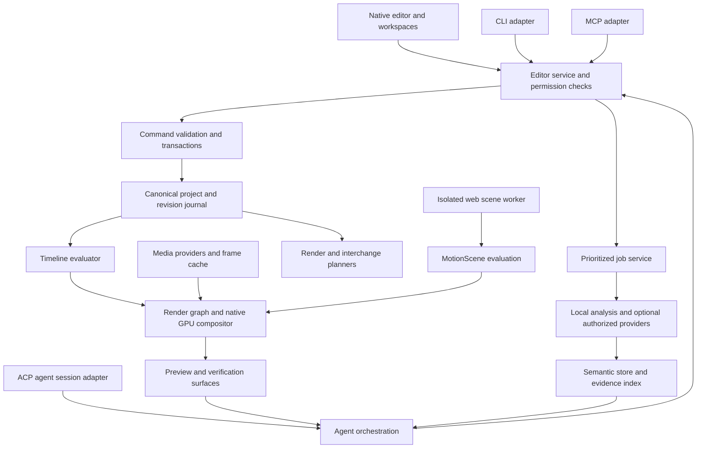

# ShotClutch — System Architecture

Baseline 0.1 · 2026-10-26 · See [01](01_PRODUCT_VISION.md) for accepted direction versus proposed implementation choices.

## Architectural shape

ShotClutch is a native desktop editor with a headless-capable engine and replaceable clients. The fork is a starting implementation, not an external runtime service. The initial plan retains the inherited native UI, exact-time model, media abstractions, command registry, and working editing behavior where an audit confirms their fitness. Missing functionality is implemented as ShotClutch components.

The diagram is logical. It does not mandate a process per box. The core service owns canonical state. Codecs, models, render workers, and scene runtimes can run out of process when isolation or platform interoperability requires it.

## Component responsibilities

| Component | Owns | Must not own |
|---|---|---|
| Editor shell | Panels, selection, input, user feedback, accessibility | A second authoritative timeline or direct database mutation |
| Editor service | Typed queries/commands, grants, revisions, event stream | Model-specific decision making |
| Project store | Canonical entities, journal, migrations, durable references | Disposable decoded frames |
| Job service | Priorities, quotas, cancellation, progress, checkpointing | Implicit editorial decisions |
| Media subsystem | Demux/decode, timestamp maps, proxies, frame/audio providers | Agent prompts or take selection policy |
| Timeline/render engine | Time mapping, effect evaluation, GPU composition, final audio/video | Protocol-specific session state |
| MotionScene runtime | Pure scene evaluation and explicit web fallback | Ordinary footage decode ownership or unrestricted filesystem access |
| Semantic subsystem | Observations, embeddings, transcripts, retrieval, freshness | Unreviewed timeline changes |
| Smart Rough Cut | Analysis policies, maps, take groups, review state | Destructive source-file rewriting |
| Agent orchestration | Context, plans, budgets, evidence, verification, reports | Permission bypass or direct project writes |
| Interchange adapters | Destination mapping, packaging, fidelity reports | Persistent replacement of the project model |

## Canonical state and derived representations

Extend one canonical project with PreEditAnalysis, PreEditMap, TakeGroup, MotionScene, semantic references, agent metadata, and interchange metadata. Adapt the inherited schema rather than wrapping it with a competing timeline. Timeline evaluation, SceneIR, search indexes, and interchange IR are derived views. They may be cached but cannot become competing authorities.

Every mutation is validated against a project revision and produces a new revision through the command service. A query may request a pinned revision. Events contain the revision and changed IDs, allowing clients to invalidate views without reloading all media. Clients that fall behind the bounded event stream must resynchronize from a snapshot.

## Main processing flows

### Import and indexing

1. User grants access to files or a media root.
2. Probe metadata, derive content identity, and create assets through a command.
3. Queue optional proxies, waveforms, transcripts, and semantic work with explicit resource budgets.
4. Write outputs as derived records linked to the source fingerprint and analyzer configuration.
5. Notify subscribed workspaces. Background analysis never applies a cut.

### Rough-cut workflow

Explicit invocation creates an analysis job against pinned source identities and settings. The result is a persistent proposal. Workspace decisions create new map revisions. Applying a reviewed map creates clips in a new sequence by default, recording the input map revision and target IDs. Reanalysis cannot silently overwrite those clips.

### Agent editing

An agent uses project queries, semantic retrieval, and visual/audio inspection tools. It builds a transaction against a revision, previews the affected composition, and gathers verification evidence. The service checks both the current grant and the revision at commit. Successful commit is one undo step; reports attach to that revision.

### Rendering and export

A render request pins the project revision, source bindings, output range, quality, color policy, runtime versions, and output destination. Rendering reads immutable snapshots while editing can continue. Interchange export adds a planning phase and fidelity report before creating a destination package. A completed artifact identifies exactly which project revision it represents.

## Scheduling and isolation

The audio callback must not wait for a model, disk write, web scene, or project lock. The UI thread must not decode footage or execute arbitrary scene code. Foreground playback and interactive seeks outrank indexing, thumbnails, and speculative agent work. Final exports receive explicit user-selected resource budgets and do not masquerade as interactive jobs.

Cancellation is cooperative where supported and process-enforced for untrusted workers. Results carry a generation token so canceled or superseded jobs cannot publish stale state. A worker crash yields a typed error and restart opportunity; it must not corrupt canonical state. Large buffers cross process boundaries using handles/shared memory where feasible, with lifetimes explicit and copying measured.

## Integration boundaries

All public adapters use a common service contract, but ACP and MCP retain their distinct protocol roles. ACP coordinates agent sessions and permission interactions; MCP exposes tools/resources; CLI supports scripted and headless use; Skills supply instructions and templates. Native UI technology is independent from MotionScene authoring technology. Using TS/JSX for scenes does not require a web-based editor shell.

Reserve extension points for effects, analyzers, import/export adapters, scene components, tools, and panels. These are architectural seams, not a promise of a public plugin SDK or marketplace in v0.1. Executable extensions require a separate capability and isolation design.

## Foundation audit and change strategy

Before renaming identifiers or changing schemas, record the fork revision, build recipe, applicable notices, supported platforms, command inventory, time representation, persistence paths, decoder behavior, GPU/CPU paths, existing tests, and interchange hooks. Classify each capability as verified, partial, absent, or unknown. Record reproducible fixtures rather than relying on documentation claims.

Keep upstream changes reviewable through a documented merge/cherry-pick policy, a patch inventory for core changes, and regression fixtures. No upstream sync may overwrite ShotClutch schema extensions, grants, or project migration rules. A frontend replacement, storage replacement, or timebase refactor requires a decision record with migration and rollback plans.

## Failure containment and observability

Log operation ID, project revision, duration, queue delay, worker/backend, and structured error category. Avoid transcripts, prompts, paths, and imagery in default diagnostics. Expose local job progress, current decoder, preview quality, cache pressure, and pending approvals in understandable UI. Detailed diagnostic exports are user-triggered and redacted.

Offline or failed providers do not prevent manual editing. Unavailable semantic models reduce search features. A broken scene can show a labeled error surface in preview, while final export blocks unless the user explicitly selects an allowed replacement. Missing media is never substituted with a different file merely because its name matches.

Related contracts: [project model](04_PROJECT_DATA_MODEL.md), [transactions](05_EDITOR_COMMAND_AND_TRANSACTION_MODEL.md), [engine](06_MEDIA_AND_RENDER_ENGINE.md), [permissions](13_SECURITY_PRIVACY_AND_PERMISSIONS.md).
